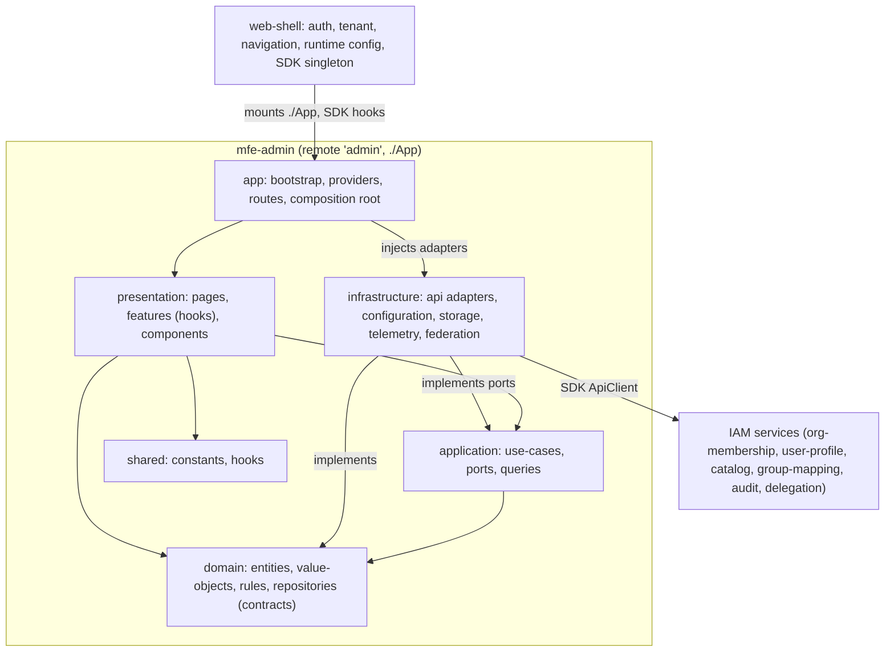

# Constitution refactoring outputs (mfe-admin)

The remaining required outputs of the Frontend Architecture Constitution's "Required Output For Architecture Refactoring", as of 2026-11-25. Items 1 and 2 (assessment, violations) are in [constitution-assessment.md](constitution-assessment.md); item 7 (ADRs) is `docs/adr/0001` to `0005`. This remote was built to the constitution, so items 8 to 10 were small: the one structural fix (use cases, ADR 0004) kept every screen, route and test, and changed no public contract.

## 3. Target architecture

Rules (enforced by `npm run arch-lint` and `test/unit/architecture/layers.test.ts`): presentation to application to domain; infrastructure implements domain contracts and application ports; domain imports nothing of ours and no packages; application has no React, SDK or browser APIs; presentation never imports infrastructure.

## 4. Folder restructuring plan

The constitution's structure against `src/` today. A folder is created when its first file exists (git does not keep empty folders), not before.

| Constitution folder | State | Action |
|---|---|---|
| `app/` bootstrap, providers, routes | Present (also `layouts/`, `styles/`) | None |
| `presentation/` pages, features, components | Present | None |
| `presentation/widgets/` | Absent | Create with the first composite widget that two pages share (none yet) |
| `application/use-cases/` | **Done** (35, ADR 0004) | None |
| `application/queries/` | Present (`keys`, `userBatcher`) | None |
| `application/commands/`, `services/` | Absent | Create when an orchestration needs them; write flows (partial-failure retry) are the first candidates and go into the use case first |
| `domain/` all five | Present | None |
| `infrastructure/api`, `configuration`, `storage`, `telemetry`, `federation` | Present | None |
| `infrastructure/auth/` | Absent, on purpose | Authentication is the shell's; the remote reads the SDK and holds no token. Do not create |
| `shared/ui`, `types`, `utilities` | Absent | `ui` waits for `platform-design-system` (ADR 0003); `types` and `utilities` when a second layer needs one (today `shared/` holds `constants`, `hooks`) |
| `src/tests/` | Tests are in `test/` at the repo root | Accepted: not part of the runtime tree, excluded from the bundle and arch-lint |

## 5. Dependency cleanup plan

Checked 2026-11-25 against `package.json` and the import graph:

- Removed: `vitest`, `@vitest/coverage-v8`, `@vitejs/plugin-react` (ADR 0005); `vite` is gone from the lockfile.
- No unused dependency remains: each is imported, or named by a config (Rsbuild, PostCSS, Tailwind, ESLint, TypeScript).
- `happy-dom` is 21.x through `overrides` (Rstest's peer range says 20.x, which has open high advisories); `npm audit` reports 0.
- Forbidden imports (React or browser APIs in `domain/` and `application/`, infrastructure from presentation) are caught by arch-lint and the layers test.
- Watch: the SDK is `1.0.0-alpha.10` and Rstest is 0.x; upgrade the shell first on an SDK bump.

## 6. Migration roadmap

| # | Step | State |
|---|---|---|
| 1 | Layer structure, arch-lint, layers test | Done |
| 2 | Repository ports and adapters, contract tests against the pinned Swagger | Done |
| 3 | Use cases in the application layer, hooks call `execute()` | Done (ADR 0004) |
| 4 | Build and test on Rsbuild and Rstest, no Vite | Done (ADR 0005) |
| 5 | Mounts in web-shell (manifest entry, `/admin/*` route, allowed origin) | Done: web-shell `0.5.0` mounts it; `infrastructure/federation/navigation.ts` holds this remote's one cross-remote move (the plan upgrade); the remote entry itself comes from the preset and `config/remote-manifest-entry.mjs` |
| 6 | Admin spec in web-shell's production-CSP contract suite | Open (LLD §15 #10) |
| 7 | `platform-design-system` instead of Tailwind and daisyUI | Blocked until it is published (ADR 0003) |
| 8 | Common identity package for the shared components | Open, owner undecided (LLD §15 #5) |
| 9 | Session-context refresh in the SDK | Done: SDK `1.0.0-alpha.10` `useRefreshSessionContext`, used by `useSessionRefresh` (LLD §15 #15); only IAM's P-35 cache lag is open |
| 10 | Zustand, only if state shared across screens appears | Not needed today (ADR 0002) |
